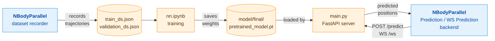

# GNN: learned N-body simulator

A graph neural network that learns to predict gravitational N-body motion, plus a FastAPI server that runs the trained model for the Unity client in [Banhellow/NBodyParallel](https://github.com/Banhellow/NBodyParallel).

The model follows the Graph Network-based Simulator (GNS) approach from [*Learning to Simulate Complex Physics with Graph Networks*](https://arxiv.org/abs/2002.09405) (Sanchez-Gonzalez et al., 2020). Bodies are nodes and their pairwise interactions are edges. A stack of interaction-network layers predicts each body's acceleration, which is integrated into its next position.

## How it fits together



Blue boxes are in the [NBodyParallel](https://github.com/Banhellow/NBodyParallel) Unity project. Orange boxes are in this repository.

## Model

| Component | Details |
|---|---|
| Input | Last 7 positions of each body, used as 5 velocity steps |
| Node features | 16-dim embedding of the particle type (5 types) + the flattened velocity history |
| Graph | Radius graph with self-loops. The radius is large enough that the graph is effectively fully connected. |
| Edge features | Relative displacement (scaled) and distance |
| Processor | 10 interaction-network layers, hidden size 128, residual connections, sum aggregation |
| Output | Per-body 3-D acceleration |
| Integration | `p(t+1) = p(t) + (p(t) − p(t−1)) + a` |

Code: `model/mlp.py`, `model/graph_network.py` (`InteractionNetwork`), `model/learning_simulator.py` (`LearningSimulator`).

## Repository contents

| Path | Purpose |
|---|---|
| `main.py` | FastAPI app with the `/predict` and `/ws` endpoints |
| `server/model_service.py` | Loads the weights, builds the graph and runs inference |
| `model/` | Model definition |
| `model/final/pretrained_model.pt` | Trained weights (state dict under the `model` key) |
| `nn.ipynb` | Data loading, graph visualisation, training and evaluation |
| `train_ds.json` | Training data: 100 bodies × 18,000 frames, all mass 1 |
| `validation_ds.json` | Validation data: 100 bodies × 2,000 frames |
| `data_set.json`, `metadata.json` | Earlier sample files, not used by the current code |

The datasets were recorded with NBodyParallel's dataset recorder. The format is:

```json
{ "entries": [ { "mass": 1, "positions": [[x, y, z], ...] }, ... ] }
```

## Installation

`requirements.txt` is a full `pip freeze` of the original Windows environment (Python 3.12, CUDA 12.1). On Windows with an NVIDIA GPU:

```bash
python -m venv .venv
.venv\Scripts\activate
pip install -r requirements.txt
```

On Linux or macOS that file will fail because it pins Windows-only packages (`pywin32`, `tensorflow_intel`). Install only the packages the code needs:

```bash
python -m venv .venv && source .venv/bin/activate
pip install torch==2.5.1 --index-url https://download.pytorch.org/whl/cu121   # or .../whl/cpu
pip install torch_geometric==2.6.1
pip install torch_scatter torch_cluster -f https://data.pyg.org/whl/torch-2.5.0+cu121.html   # or +cpu
pip install numpy fastapi "uvicorn[standard]"
# for the notebook:
pip install jupyter matplotlib ipympl networkx tqdm
```

## Running the server

```bash
uvicorn main:app --host 127.0.0.1 --port 8000
```

The Unity client expects the server at `127.0.0.1:8000`. Once it is running, open NBodyParallel and pick the **Prediction** or **WS Prediction** backend.

### `POST /predict`

Predicts one step ahead.

Request:

```json
{
  "particle_types": [1, 1, 1],
  "positions": [ [[x, y, z], ... 7 frames], ... one list per body ]
}
```

- `positions` has shape `[bodies][7][3]` (body-major).
- `particle_types` must be integers 0–4. The bundled model was trained on type `1` only.

Response:

```json
{ "predicted_position": [[x, y, z], ...] }
```

### `WS /ws`

Runs an autoregressive rollout.

1. The client sends one init message:

   ```json
   { "type": "init", "particle_types": [1, 1, 1], "positions": [ [[x, y, z], ... one per body], ... 7 frames ] }
   ```

   Here `positions` has shape `[7][bodies][3]` (frame-major).
2. The server then sends `{ "predicted_position": [[x, y, z], ...] }` messages continuously. Each prediction is appended to the server's window and used as input for the next one.

`GET /` returns a hello message and can be used as a health check.

## Training

Open `nn.ipynb` and run the cells in order. The notebook:

1. Loads `train_ds.json` and `validation_ds.json`.
2. Splits each trajectory into non-overlapping 7-frame windows: 6 input frames and 1 target frame.
3. Visualises a sample graph.
4. Trains a `LearningSimulator(128, 10, 16, 3, 5)`.

Training settings (the `params` cell):

- Adam, learning rate 1e-4 with exponential decay
- batch size 1
- 100 epochs
- evaluation and checkpointing every 1,000 steps

Before you train:

- **A CUDA GPU is required.** The training loop calls `.cuda()`.
- **Create `model/checkpoints/`** first. It is git-ignored, and checkpoints are written there.
- **Remove or install TensorFlow.** The first cell imports it, but it is not used.

The final weights are saved to `model/final/pretrained_model.pt`. That is the file the server loads.

## License

No license file has been added yet.
